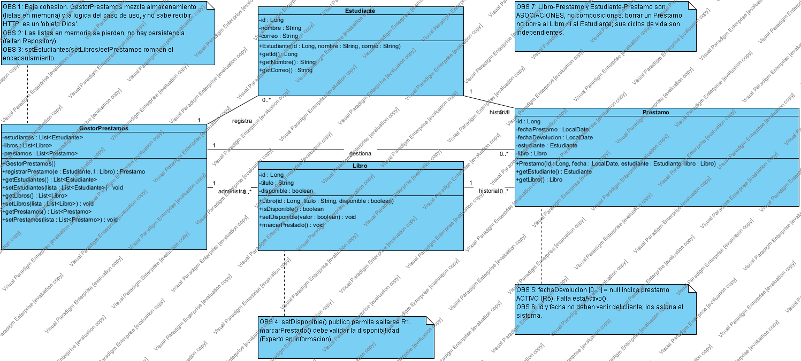
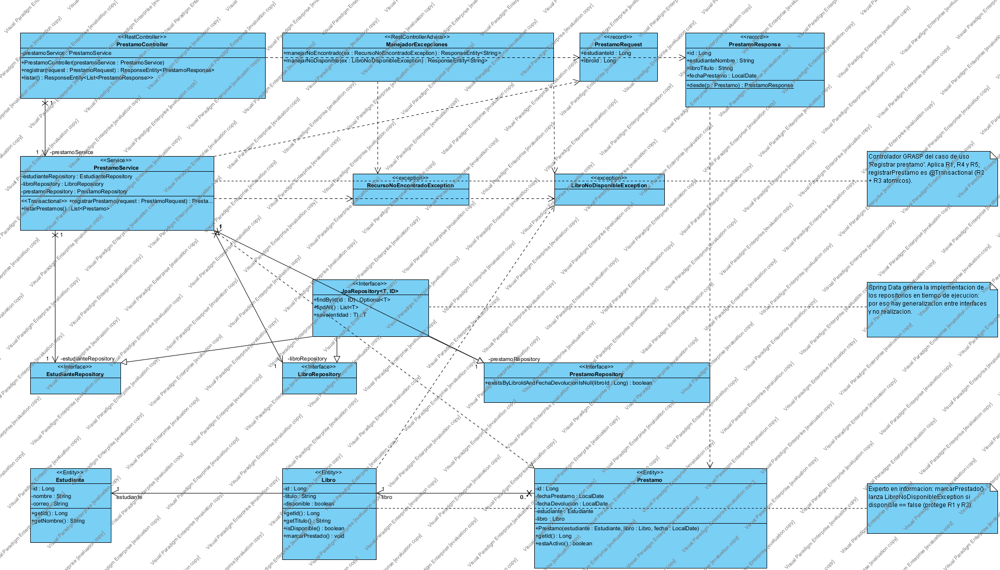
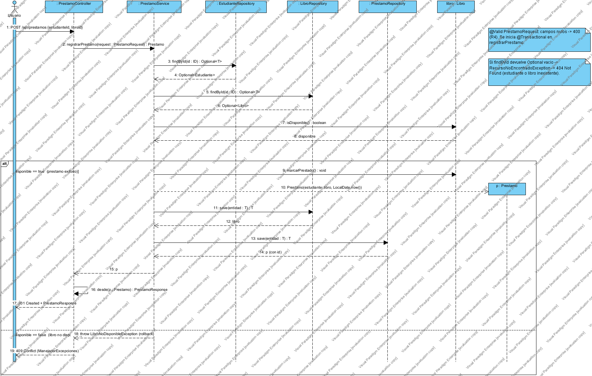

# Taller práctico Bloque 7 · SmartLibrary

**Diseño de Software · Cuarto semestre**

Este taller rediseña el modelo de clases inicial de SmartLibrary (centrado en `GestorPrestamos`) en tres capas, **Controller → Service → Repository**, para una API REST con Spring Boot. El caso de uso que se resuelve es **Registrar préstamo** (`POST /api/prestamos`).

## Contenido del repositorio

```
├── enunciado/
│   └── Taller practico bloque 7.docx        Enunciado original del taller
├── diagramas/
│   ├── visual-paradigm/
│   │   └── SmartLibrary_Taller7.vpp         Proyecto Visual Paradigm con los 3 diagramas
│   ├── imagenes/                            Diagramas exportados en PNG
│   └── plantuml/                            Los mismos diagramas en PlantUML
└── solucion/
    └── taller_resuelto.html                 Solución completa (actividades 1 a 7)
```

Para abrir los diagramas: en Visual Paradigm, *File → Open Project* y elegir `diagramas/visual-paradigm/SmartLibrary_Taller7.vpp`.

## Reglas del caso

| Regla | Descripción |
|---|---|
| R1 | Solo un libro disponible puede prestarse |
| R2 | El préstamo registra estudiante, libro y fecha |
| R3 | Al prestarlo, el libro deja de estar disponible |
| R4 | Una solicitud inválida no debe crear préstamo |
| R5 | Un libro puede tener varios préstamos históricos, pero solo uno activo |

## Actividad 1 · Modelo inicial anotado



- `GestorPrestamos` tiene baja cohesión: guarda colecciones en memoria y además coordina el caso de uso. No hay capa HTTP ni persistencia.
- Libro–Prestamo y Estudiante–Prestamo son **asociaciones, no composiciones**: el libro y el estudiante existen antes y después del préstamo, y borrar un préstamo no los borra.
- Faltan un `PrestamoController` (entrada y salida HTTP) y repositorios (acceso a datos).

## Actividad 2 · Tabla de responsabilidades

| Operación o decisión | Clase responsable | Justificación |
|---|---|---|
| Recibir `POST /api/prestamos` | PrestamoController | Frontera HTTP: mapea la ruta y valida el `PrestamoRequest` con `@Valid` |
| Buscar estudiante por identificador | EstudianteRepository (lo invoca PrestamoService) | Acceso a datos de una sola entidad (`findById`) |
| Buscar libro por identificador | LibroRepository (lo invoca PrestamoService) | Acceso a datos de una sola entidad (`findById`) |
| Validar disponibilidad | PrestamoService + Libro | Regla de negocio (R1, R5). El dato y la verificación pertenecen a `Libro` (Experto en información) |
| Crear el préstamo | PrestamoService | Creador (GRASP): tiene estudiante, libro y fecha (R2) |
| Cambiar disponibilidad | `Libro.marcarPrestado()` | Experto en información: el libro protege su propio estado (R3) |
| Guardar cambios | PrestamoRepository y LibroRepository | `save()` dentro de una transacción `@Transactional` (R4) |
| Devolver respuesta HTTP | PrestamoController y ManejadorExcepciones | 201 Created; las excepciones se traducen a 404 y 409 |

## Actividad 3 · Diagrama de clases por capas



- **Entre capas:** asociaciones dirigidas 1 a 1, porque cada capa guarda la siguiente como atributo inyectado. El Controller nunca usa un Repository.
- **Dominio:** `Prestamo` 0..* → 1 `Estudiante` y `Prestamo` 0..* → 1 `Libro`, navegables desde `Prestamo`.
- **Repositorios:** interfaces que extienden `JpaRepository` (generalización). No hay realización, porque Spring Data genera la implementación.
- **Dependencias «use», «create» y «throw»:** se usan para los DTO, la creación de `Prestamo` y las excepciones, que son usos puntuales sin atributo.

## Actividad 4 · Diagrama de secuencia



El diagrama tiene un fragmento `alt` con dos caminos: **préstamo exitoso** (201 Created) y **libro no disponible** (409 Conflict, con rollback). Cada mensaje está enlazado a una operación del diagrama de clases.

## Actividades 5 y 6 · Pruebas esperadas

| Escenario | Resultado esperado |
|---|---|
| Préstamo de libro disponible | 201 Created y préstamo registrado |
| Libro ya prestado | 409 Conflict, sin préstamo nuevo |
| Estudiante inexistente | 404 Not Found |
| Libro inexistente | 404 Not Found |
| Consulta de préstamos | 200 OK con registros |

## Actividad 7 · Defensa

- **Patrón GRASP:** Controlador. Está en `PrestamoService`, que coordina el caso de uso. El `@RestController` solo traduce HTTP, así que no es el controlador GRASP.
- **Regla de disponibilidad:** está en la capa de negocio. El servicio la aplica dentro de la transacción y `Libro.marcarPrestado()` la protege.
- **Trazabilidad:** requisito → clase → operación → prueba. Por ejemplo: R1 → `Libro` → `isDisponible()` / `marcarPrestado()` → prueba "libro ya prestado devuelve 409".

La versión completa de todas las respuestas está en [`solucion/taller_resuelto.html`](solucion/taller_resuelto.html).
