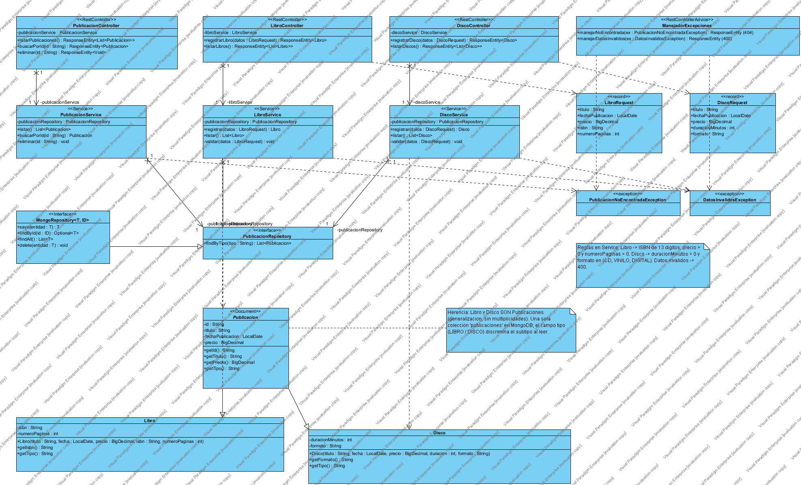
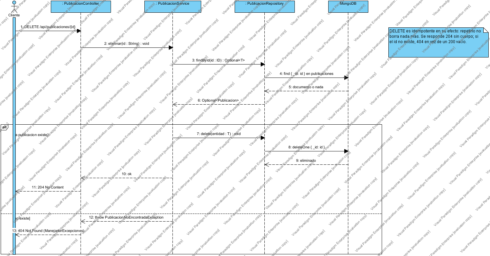
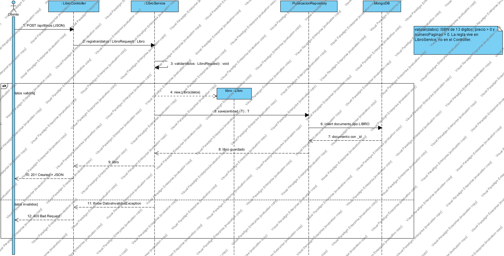

# Actividad de cierre · Caso Editorial

Esta carpeta resuelve la actividad de las diapositivas **"De la Web a una API REST con Spring Boot y MongoDB"** (diapositivas 26 y 27). El caso tiene una superclase `Publicacion` con dos subtipos, `Libro` y `Disco`, que se persisten en MongoDB y se exponen como API REST en tres capas.

**Diagramas** (proyecto Visual Paradigm `diagramas/Editorial_ActividadCierre.vpp`):

| Diagrama | Contenido |
|---|---|
|  | **E1.** Clases en tres capas, con herencia `Publicacion → Libro / Disco` |
|  | **E2.** Reto: secuencia de `DELETE /api/publicaciones/{id}` |
|  | **E3.** Secuencia de `POST /api/libros` con validación en el Service |

## 1. Endpoints propuestos

Las rutas nombran recursos en plural y el método HTTP expresa la operación (diapositiva 6).

| Método | Ruta | Capacidad | Respuestas |
|---|---|---|---|
| GET | `/api/publicaciones` | Listar publicaciones de ambos tipos | 200 (la lista puede estar vacía) |
| GET | `/api/publicaciones/{id}` | Consultar una publicación | 200, 404 |
| DELETE | `/api/publicaciones/{id}` | Eliminar una publicación (reto) | 204, 404 |
| POST | `/api/libros` | Registrar un libro | 201, 400 |
| GET | `/api/libros` | Listar solo libros | 200 |
| POST | `/api/discos` | Registrar un disco | 201, 400 |
| GET | `/api/discos` | Listar solo discos | 200 |

Libros y discos se **crean** por rutas separadas porque cada tipo tiene datos y reglas distintas. Se **consultan y eliminan** por `/api/publicaciones`, porque esas operaciones son iguales para cualquier tipo.

## 2. Tabla de responsabilidades

| Operación | Controller | Service | Repository |
|---|---|---|---|
| Registrar libro | `LibroController.registrarLibro`: recibe el JSON y responde 201 o 400 | `LibroService.registrar`: valida las reglas del libro y crea el `Libro` | `PublicacionRepository.save`: inserta el documento con `tipo = LIBRO` |
| Registrar disco | `DiscoController.registrarDisco` | `DiscoService.registrar`: valida las reglas del disco y crea el `Disco` | `PublicacionRepository.save` |
| Listar libros / discos | `LibroController.listarLibros` / `DiscoController.listarDiscos` | `LibroService.listar` / `DiscoService.listar` | `PublicacionRepository.findByTipo` |
| Listar publicaciones | `PublicacionController.listarPublicaciones` | `PublicacionService.listar` | `findAll` (devuelve documentos LIBRO y DISCO) |
| Consultar por id | `PublicacionController.buscarPorId`: responde 200 o 404 | `PublicacionService.buscarPorId`: lanza `PublicacionNoEncontradaException` si no existe | `findById` |
| Eliminar | `PublicacionController.eliminar`: responde 204 o 404 | `PublicacionService.eliminar`: verifica que exista y luego elimina | `findById` + `delete` |
| Traducir errores a HTTP | `ManejadorExcepciones` (`@RestControllerAdvice`): 404 y 400 | — | — |

**Justificación.** Cada capa responde una sola pregunta (diapositiva 22). El **Controller** se ocupa de cómo entra y sale la información por HTTP. El **Service** decide qué reglas y pasos exige el caso de uso. El **Repository** resuelve cómo se guarda y consulta en MongoDB. Hay **un solo repositorio**, porque libros y discos se guardan en la misma colección `publicaciones`, y **tres servicios**, porque las reglas de cada tipo son distintas (alta cohesión). `Publicacion`, `Libro` y `Disco` son el modelo de dominio que usan las tres capas; no forman una cuarta capa.

## 3. ¿Por qué el Controller no debe guardar directamente en MongoDB?

- **Se saltaría las reglas de negocio.** Si el Controller llama a `save()`, nadie valida el ISBN, el precio ni el formato, y cualquier otro punto de entrada tendría que repetir esas validaciones.
- **Acoplamiento alto.** El Controller quedaría atado a HTTP y a MongoDB al mismo tiempo; un cambio en la base o en las reglas obligaría a tocar la capa web.
- **Baja cohesión.** Una clase haría tres trabajos distintos, que es justo el problema del `GestorPrestamos` del taller SmartLibrary.
- **Pruebas más difíciles.** Con capas, el Service se prueba sin servidor web y el Controller se prueba con un Service simulado.
- **Seguridad.** Cliente → API → base. Por esa misma razón el navegador nunca se conecta directo a MongoDB (diapositiva 4).

## 4. Reglas de negocio que se validan en el Service

| Tipo | Regla | Si no se cumple |
|---|---|---|
| **Libro** | El ISBN debe tener exactamente 13 dígitos (ISBN-13) | 400 Bad Request |
| **Libro** | `numeroPaginas` debe ser mayor que 0 | 400 Bad Request |
| **Disco** | `duracionMinutos` debe ser mayor que 0 | 400 Bad Request |
| **Disco** | `formato` debe ser uno de `CD`, `VINILO` o `DIGITAL` | 400 Bad Request |
| Ambos | `titulo` no vacío y `precio` mayor que 0 | 400 Bad Request |

Van en el Service y no en el Controller porque son reglas del negocio editorial, no detalles de HTTP: siguen valiendo aunque los datos lleguen por otra vía.

## 5. Reto: flujo de `DELETE /api/publicaciones/{id}` (diagrama E2)

1. El cliente envía `DELETE /api/publicaciones/{id}`.
2. `PublicacionController.eliminar(id)` delega en `PublicacionService.eliminar(id)`.
3. El Service llama a `PublicacionRepository.findById(id)`, que busca `{ _id: id }` en la colección `publicaciones`.
4. **Si existe**, el Service llama a `delete(publicacion)`, el Repository ejecuta `deleteOne` en MongoDB y el Controller responde **204 No Content**, sin cuerpo.
5. **Si no existe**, el Service lanza `PublicacionNoEncontradaException` y el `ManejadorExcepciones` responde **404 Not Found**.

**Por qué 404 y no 200 vacío:** el código le dice al cliente qué pasó sin que tenga que interpretar un cuerpo vacío (diapositiva 25). **Por qué 204:** la operación salió bien y no hay nada que devolver.

## 6. Herencia y MongoDB

- `Libro` y `Disco` **son** publicaciones. Por eso se dibujan con generalización (línea continua y triángulo hueco hacia `Publicacion`) y no con una asociación, que diría "un libro *tiene* una publicación". La herencia no lleva multiplicidades (diapositivas 13 y 14).
- **Persistencia elegida:** una sola colección `publicaciones` con el campo discriminador `tipo` (`LIBRO` o `DISCO`). Así `GET /api/publicaciones` se resuelve con una sola consulta y cada documento conserva su subtipo al leerse. Spring Data MongoDB además guarda `_class` para reconstruir el objeto correcto.
- Usar colecciones separadas también sería válido. La elección es una decisión de persistencia, no algo que se deduzca de la herencia UML (diapositiva 17).
